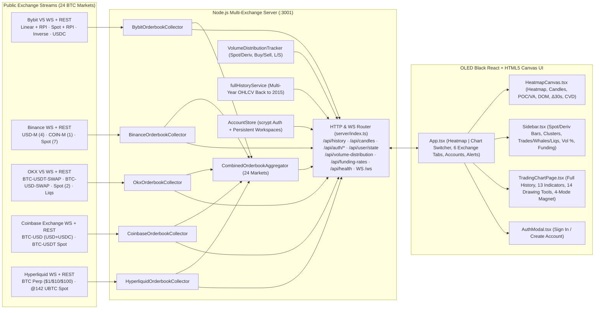

# BTC Orderbook Heatmap Chart

A real-time, OLED-black Bookmap-style **orderbook liquidity heatmap**, **TradingView-style interactive charting & drawing suite**, **derivatives analytics**, and **persistent user workspace** for **Bitcoin across 5 major exchanges (24 unified BTC markets)**:

- **Bybit** (`4 Books + RPI`)
- **Binance** (`12 Pairs` — USD-M, COIN-M, Spot)
- **OKX** (`4 Pairs` — USDT Swap, USD Swap, Spot)
- **Coinbase** (`2 Spot` — unified `BTC-USD` + `BTC-USDT`)
- **Hyperliquid** (`2 Pairs` — `BTC` Perp + `UBTC/USDC` Spot)
- **Merged** (`All 5 • 24` unified orderbooks, trades, liquidations, OI, and multi-year K-lines)

Each exchange runs an independent Node.js/TypeScript collector connecting directly to public WebSocket & REST market streams (no API keys required), maintains `$1` base-cached orderbooks with rolling ring buffers and non-blocking disk checkpoints, and streams live updates to a demand-driven HTML5 Canvas + React interface.

---

## Architecture



---

## Exchange Tabs & Liquidity Feeds

| Hotkey | Tab | Markets Included | Feed Scopes |
| :---: | :--- | :--- | :--- |
| **`1`** | **Bybit** (`4`) | Linear `BTCUSDT` + `RPI`, Spot `BTCUSDT` + `RPI`, Inverse `BTCUSD`, USDC `BTCPERP` + forced liquidations | `All Bybit Books`, `USDT Perp + RPI`, `Spot + RPI`, `Inverse BTCUSD`, `USDC BTCPERP` |
| **`2`** | **Binance** (`12`) | USD-M (`BTCUSDT`, `BTCUSDC`, `BTCUSD1`, `BTCU`), COIN-M (`BTCUSD_PERP`), Spot (`BTCUSDT`, `BTCUSDC`, `BTCFDUSD`, `BTCUSD1`, `BTCU`, `BTCUSD`, `BTCUSDS`) + `forceOrder` liquidations | `All Binance BTC (12)`, `USD-M (4)`, `COIN-M (Perp)`, `Spot (7)`, `BTCUSDT Perp` |
| **`3`** | **OKX** (`4`) | `BTC-USDT-SWAP` (`0.01 BTC/ct`), `BTC-USD-SWAP` (`$100/ct`), Spot `BTC-USDT` & `BTC-USDC` + `liquidation-orders` | `All OKX BTC (4)`, `USDT Swap`, `USD Swap`, `Spot (2)` |
| **`4`** | **Coinbase** (`2`) | `BTC-USD` (unified USD+USDC Spot book) & `BTC-USDT` Spot (maker-side flipped to taker aggressor side; resampled K-lines) | `All Coinbase (2)`, `BTC-USD`, `BTC-USDT` |
| **`5`** | **HL** (`2`) | Hyperliquid `BTC` Perp (`$1` WS inner + `$10`/`$100` non-overlapping REST layers) + `@142` `UBTC/USDC` Spot | `All HL BTC (Perp+Spot)`, `BTC Perp`, `UBTC Spot` |
| **`6`** | **Merged** (`5•24`) | All 24 markets combined with blended prices/K-lines, summed OI/volume, perp-weighted funding, and 9 venue tags (`BYB-P`, `BYB-S`, `BN-P`, `BN-S`, `OKX-P`, `OKX-S`, `HL-P`, `HL-S`, `CB-S`) | `All Merged (24)`, `Perps`, `Spot`, `Bybit`, `Binance`, `OKX`, `Coinbase`, `HL` |

---

## Core Features

### 1. Orderbook Heatmap Terminal (`/`) — [`HeatmapCanvas.tsx`](file:///home/kriyo/Projects/bybit-orderbook-heatmap/client/src/components/HeatmapCanvas.tsx)
- **True OLED Black (`#000000`)** theme across all UI panels, cards, toolbars, and canvas panes.
- **Full Timeframe Suite:**
  - **Tick Timeframes (ring buffer):** `100ms`, `250ms`, `500ms`, `1s`
  - **K-Line Timeframes:** `1m`, `3m`, `5m`, `15m` *(default)*, `30m`, `1h`, `2h`, `4h`, `6h`, `12h`, `1d`, `1w` (with automatic multi-candle resampling for unsupported native intervals like Coinbase `4h`/`12h` and Hyperliquid `6h`).
- **Candlesticks & Overlays:**
  - High-visibility black-bordered candlesticks with live OHLC tick updates.
  - **Colormaps** ([`colormaps.ts`](file:///home/kriyo/Projects/bybit-orderbook-heatmap/client/src/colormaps.ts)): `Thermal`, `Viridis`, `Bid/Ask` with throttled Auto-Contrast and manual Min/Max BTC sliders.
  - **Session Volume Profile (`Profile`):** Cached buy/sell volume distribution along the left edge with **POC**, **VAH**, and **VAL** (70% value area).
  - **Dual CVD (`Vol/CVD`):** Separate **Perp CVD** and **Spot CVD** lines in the lower volume pane, plus **Perp-Spot Basis** in the header.
  - **Forced Liquidations (`⚡Liqs`):** Real-time liquidation diamonds plotted on-chart (Bybit, Binance, OKX).
  - **DOM & 30s Spoof Delta (`Δ30s`):** 1:1 synchronized DOM depth histogram with live 30-second resting liquidity Pull/Stack delta (`+` stacked / `-` pulled).
  - **Alerts & Sound** ([`alerts.ts`](file:///home/kriyo/Projects/bybit-orderbook-heatmap/client/src/alerts.ts)): Clickable in-app toasts + Web Audio chimes for configurable whale fills (`≥ 1–25 BTC`), large liquidations (`≥ $50k`), and custom price-level alerts.

### 2. TradingView-Style Chart & Drawing Page (`/chart`) — [`TradingChartPage.tsx`](file:///home/kriyo/Projects/bybit-orderbook-heatmap/client/src/components/TradingChartPage.tsx)
Switch anytime via the **`Heatmap | Chart`** tabs in the top-left header.
- **Complete Multi-Year Historical Data** ([`fullHistoryService.ts`](file:///home/kriyo/Projects/bybit-orderbook-heatmap/server/fullHistoryService.ts)):
  - Paginated OHLCV fetcher (`GET /api/candles`) loading full Bitcoin history back to **2015** on Daily (`4,100+` bars on Merged & Coinbase) and Weekly (`590+` bars), plus deep intraday history across all 5 exchanges blended with live streaming tail candles.
- **Chart Styles & Scales:**
  - **5 Series Styles:** `Candles`, `Hollow`, `Heikin Ashi`, `Line`, `Area`.
  - **Scale Modes:** `Normal` (linear), `Log` (logarithmic), `%` (percentage), plus `Auto` Y-scale, `All (N)` full-history fit, live candle close countdown clock, and **📷 PNG** snapshot export.
- **13 Built-In Technical Indicators** ([`chartIndicators.ts`](file:///home/kriyo/Projects/bybit-orderbook-heatmap/client/src/chartIndicators.ts)):
  - **Moving Averages:** `EMA 9`, `EMA 21`, `EMA 50`, `EMA 200`, `SMA 20`, **`MA 50`**, **`MA 100`**, **`MA 200`**.
  - **Overlays & Oscillators:** `VWAP`, `Bollinger Bands (20, 2)`, `Volume` + `Vol MA(20)` sub-pane, `RSI(14)` sub-pane, and `MACD(12, 26, 9)` sub-pane with live OHLCV + indicator HUD readout.
- **14 Interactive Drawing Tools** ([`chartDrawings.ts`](file:///home/kriyo/Projects/bybit-orderbook-heatmap/client/src/chartDrawings.ts)):
  - Crosshair/Select (`Esc`), Trendline (`T`), Extended Ray (`Y`), Horizontal Line (`H`), Horizontal Ray (`J`), Vertical Line (`I`), Rectangle/Zone (`G`), Parallel Channel (`C`), Fibonacci Retracement (`X`), Long R:R Position (`L`), Short R:R Position (`S`), Price/Time Ruler (`U` or `Shift+Drag`), Freehand Brush (`P`), and Text Annotation (`N`).
  - Full anchor dragging, move drawing, 8-color swatches, `1px`/`2px`/`3px` stroke widths, solid/dashed toggle, hide/show all, undo (`Ctrl+Z`), and delete (`Del`).
- **4-Mode Magnet Snapping (`🧲` or hotkey `M`):**
  - **Off:** Free cursor placement.
  - **Weak (`W`):** Snaps within `38px` to nearby candle `O/H/L/C`.
  - **Strong (`S`):** Always locks vertically to the hovered candle's nearest `O/H/L/C`.
  - **Extra Strong (`XS`):** Wide 2D magnetic lock across `±90px` of nearby candles, prioritizing prominent swing highs/lows and wick extremes—with live crosshair snap, glowing target ring, and `O/H/L/C + price` badge right on the wick.

### 3. Right Sidebar Analytics — [`Sidebar.tsx`](file:///home/kriyo/Projects/bybit-orderbook-heatmap/client/src/components/Sidebar.tsx)
1. **Split Liquidity Imbalance Card:** Separate **DERIVS** and **SPOT** Bid vs. Ask imbalance bars (BTC, `%`, and hover imbalance tooltips) plus per-market coverage pills.
2. **BTC Cluster Buckets Matrix:** Clickable size tiers (`1–5`, `5–10`, `10–25`, `25–50`, `50–100`, `100+ BTC`) that filter the heatmap, DOM, and wall list.
3. **4-Tab Explorer:**
   - **`Clusters`:** Resting Bid/Ask walls with per-venue breakdown badges, sortable by BTC size or price (click to highlight on chart).
   - **`Trades`:** **`All`**, **`🐋 Whales`** (`≥ 0.5–10 BTC` & Buy/Sell filters, net whale flow), and **`⚡ Liqs`** (Long/Short liquidation USD totals).
   - **`Vol %`:** 5-exchange 24h BTC volume distribution (`All (5)`, `Spot`, `Derivatives`), **Buy vs. Sell volume bars**, and **Long vs. Short** positioning (`Accounts` ratios for Binance/Bybit/OKX, live perp `Flow` for Hyperliquid).
   - **`Funding`:** Live perpetual funding rates with **OI-Weighted 8h rate & APR**, cross-exchange arb spread, Hyperliquid `1h` → `8h` normalization (`×8`), OI, and next UTC settlement countdown.

### 4. Accounts & Persistent Workspace — [`authStore.ts`](file:///home/kriyo/Projects/bybit-orderbook-heatmap/server/authStore.ts), [`AuthModal.tsx`](file:///home/kriyo/Projects/bybit-orderbook-heatmap/client/src/components/AuthModal.tsx)
Click **Sign In** in the top-right header (or **💾 Save to Account** in the Chart toolbar) to create a local server account and keep your entire setup across browser reloads and server/Docker restarts:
- **Zero-Dependency Security:** Salted `crypto.scryptSync` password hashing (`timingSafeEqual`), 30-day `HttpOnly; SameSite=Lax` session cookies, atomic `0600` persistence to `DATA_DIR/accounts.json` (`server/data/accounts.json` locally; `/app/server/data/accounts.json` on the `heatmap_data` volume in Docker).
- **Everything Saved Automatically (with tab-close `keepalive` flush):**
  - Active page (`Heatmap` / `Chart`), selected exchange, all 6 exchange feed scopes, Heatmap timeframe, dedicated Chart timeframe, price step, colormap, cluster filter, contrast settings, all 7 heatmap layer toggles, sound & whale/price alert thresholds.
  - All Chart settings (candle style, scale mode, Auto-Scale Y, all 13 indicators, drawing color/width/dashed, 4-mode magnet, hide drawings), **Chart zoom/pan/manual Y-axis viewports per exchange & timeframe**, and up to **500 drawings per exchange** across all 6 exchanges.

---

## Performance Optimizations

- **Backend CPU, Memory & I/O:**
  - `$1` base aggregation caching + zero-allocation `reBucketAggregatedResult()` fast path on lite ticks (skipping per-level `VenueBreakdown` objects on 3 of 4 ticks/sec).
  - **O(1) incremental Best Bid/Ask tracking** across Bybit, Binance, OKX, and Coinbase, `±18%` orderbook retention cap, and `< 0.005 BTC` dust pruning.
  - Pre-loaded & pre-gzipped in-memory static asset cache (`ETag`, `304 Not Modified`, `Cache-Control: public, max-age=31536000, immutable` for `/assets/*`).
  - Non-blocking async `zlib.gzip` for large JSON responses (`> 16 KB`), async write-coalesced account saves (`flushSync()` on shutdown), staggered async checkpoints, idle kline pre-warm pause when no clients are connected, and bounded LRU cache (`24` entries) in `fullHistoryService.ts`.
- **Network & Frontend Rendering:**
  - Ultra-lite **`mode: 'chart'`** WebSocket streaming cuts Chart-page WS bandwidth by **~97%** (`~62 KB → ~1.9 KB/tick`) and pauses heatmap-only API polling while on `/chart`.
  - Code-split production bundle (`react-vendor`, `index`, lazy-loaded `TradingChartPage` & `AuthModal`) cutting initial wire transfer by **-73%** (`383 KB → 104 KB` gzipped).
  - **Demand-driven `requestAnimationFrame`** (`0%` idle CPU) on both Heatmap and Chart canvases, batched Canvas 2D paths for grids/candles/volume/MACD, cached Session Volume Profile (`POC`/`VAH`/`VAL`), cached `Intl.DateTimeFormat` formatters, `O(N)` sliding-window Bollinger Bands, `O(1)` live-tail candle merging, zero-re-render drawing drags, `React.memo` on heavy panels, and `visibilitychange` background throttling.

---

## Navigation & Keyboard Shortcuts

### Global & Heatmap (`/`)
| Input | Action |
| :--- | :--- |
| **`1` – `6`** | Switch exchange tabs (`1` Bybit, `2` Binance, `3` OKX, `4` Coinbase, `5` HL, `6` Merged) |
| **`Space`** | Pause / Resume live stream |
| **`F`** | Auto-fit visible candlesticks |
| **`R`** | Recenter tightly on live Best Bid / Best Ask spread |
| **`B`** | Zoom out to full exchange orderbook |
| **`M`** | Mute / Unmute alert audio chimes |
| **`Esc`** | Clear highlighted price line |
| **Mouse Wheel / `Shift+Wheel` / `Ctrl+Wheel`** | Zoom price (Y), zoom time (X), or zoom both simultaneously |
| **Drag Chart / Price Axis / Time Axis** | 2D pan, vertical scale zoom, or horizontal scale zoom |

### TradingView Chart (`/chart`)
| Input | Action |
| :--- | :--- |
| **`T` / `Y` / `H` / `J` / `I`** | Trendline / Extended Ray / Horizontal Line / Horizontal Ray / Vertical Line |
| **`G` / `C` / `X`** | Rectangle / Parallel Channel / Fibonacci Retracement |
| **`L` / `S` / `U` / `P` / `N`** | Long R:R / Short R:R / Price-Time Ruler (`Shift+Drag`) / Brush / Text Note |
| **`M`** | Cycle Magnet Mode (`Off` → `Weak` → `Strong` → `Extra Strong`) |
| **`Ctrl+Z` / `Del` / `Esc`** | Undo last drawing / Delete selected drawing / Return to crosshair |
| **Double-Click Chart / Price Axis** | Reset viewport & auto-scale Y / Reset Y-axis auto-scale |

---

## Running with Docker (Recommended)

Requires Docker + Docker Compose ([`Dockerfile`](file:///home/kriyo/Projects/bybit-orderbook-heatmap/Dockerfile), [`docker-compose.yml`](file:///home/kriyo/Projects/bybit-orderbook-heatmap/docker-compose.yml)):

```bash
docker compose up -d --build
```

The multi-stage `node:24-alpine` container builds the split frontend bundle, installs production dependencies only, runs as non-root user `node`, binds `HOST=0.0.0.0` on port `3001`, persists accounts and checkpoints to the `heatmap_data` Docker volume (`/app/server/data`), and monitors `/api/health` via a built-in `HEALTHCHECK`.

Open **[http://127.0.0.1:3001](http://127.0.0.1:3001)** (or **[http://127.0.0.1:3001/chart](http://127.0.0.1:3001/chart)**) in your browser.

Useful commands:
```bash
docker ps                                          # verify (healthy) & 0.0.0.0:3001->3001/tcp
docker logs -f btc-orderbook-heatmap-chart         # stream live WS connection logs
docker compose down                                # stop container (keeps accounts & checkpoints volume)
```

---

## Local Setup & Development

### Prerequisites
- **Node.js `22.6+` / `24.x` / `26.x`** (native `--experimental-strip-types`).

```bash
npm install
```

### Production Mode (Unified Server on `:3001`)
```bash
npm run build
npm start
```
Open **[http://127.0.0.1:3001](http://127.0.0.1:3001)** (`HOST=0.0.0.0 PORT=4000 npm start` to customize bind address/port).

### Development Mode (Hot Reload)
```bash
# Terminal 1 — Backend Collectors & API (:3001)
npm run dev:server

# Terminal 2 — Vite Frontend (:5173, proxies /api and /ws to :3001)
npm run dev:client
```

### Typecheck & Unit Tests
```bash
npx tsc --noEmit
npm test
```

---

## HTTP & WebSocket API

- **`GET /api/health`** — Memory stats (`rss`, `heapUsed`, `heapTotal`) + live `TickerStats` for all 5 exchanges and `combined`.
- **`GET /api/history`** — Heatmap history & live book (`exchange`, `timeframe`, `priceStep`, `bookScope`).
- **`GET /api/candles`** — Complete multi-year paginated OHLCV candle history (`exchange`, `timeframe`) back to 2015.
- **`GET /api/volume-distribution`** — 5-exchange 24h Spot & Derivatives BTC/USD volumes, percentage shares, Buy vs. Sell splits, and Long vs. Short ratios.
- **`GET /api/funding-rates`** — Live perpetual funding rates, 8h-normalized rates, annualized APR, OI-weighted aggregate rate, arb spread, mark/index basis (bps), and next UTC settlement timestamps.
- **`POST /api/auth/register` · `POST /api/auth/login` · `POST /api/auth/logout` · `GET /api/auth/me`** — Cookie-authenticated account management.
- **`PUT /api/user/state`** — Persist full authenticated user workspace (heatmap settings, chart settings, chart viewports, and drawings across all exchanges).
- **`WS /ws`** — Send `{ "type": "config", "exchange": "...", "bookScope": "...", "priceStep": 10, "mode": "heatmap" | "chart" }` to stream `250ms` live `tick` frames.

---

## Project Structure

```text
btc-orderbook-heatmap-chart/
├── Dockerfile                           # Multi-stage node:24-alpine production image
├── docker-compose.yml                   # Compose service with port 3001 & persistent data volume
├── .dockerignore
├── index.html
├── package.json
├── tsconfig.json
├── vite.config.ts                       # Code-split production build (react-vendor + lazy routes)
├── shared/
│   └── types.ts                         # Shared types for exchanges, chart settings, viewports & auth
├── server/
│   ├── index.ts                         # HTTP/WS router, in-memory gzip static cache, auth & candles API
│   ├── authStore.ts                     # Salted scrypt auth, 30-day sessions & async workspace persistence
│   ├── fullHistoryService.ts            # Paginated multi-year OHLCV history service (back to 2015)
│   ├── collectorUtils.ts                # Bucketing, fast-path re-bucketing, cluster tiers & async checkpoints
│   ├── bybitCollector.ts                # Bybit 4-market + RPI + liquidations collector
│   ├── binanceCollector.ts              # Binance 12-pair (USD-M, COIN-M, Spot) + forceOrder collector
│   ├── okxCollector.ts                  # OKX 4-pair (USDT/USD Swaps, Spot) + liquidations collector
│   ├── coinbaseCollector.ts             # Coinbase Spot (BTC-USD + BTC-USDT) collector
│   ├── hyperliquidCollector.ts          # Hyperliquid BTC Perp ($1/$10/$100) + @142 UBTC Spot collector
│   ├── combinedCollector.ts             # Unified 5-exchange (24-market) aggregator & K-line blender
│   ├── volumeTracker.ts                 # 5-exchange Spot/Deriv volume, Buy/Sell & Long/Short tracker
│   └── data/                            # Runtime JSON checkpoints & accounts.json (git/docker ignored)
├── tests/
│   ├── authStore.test.ts                # Account registration, login, session & disk reload tests
│   ├── collectorUtils.test.ts           # Core collector bucketing, cluster & trade buffer tests
│   └── optimizations.test.ts            # Fast-path re-bucketing & O(N) Bollinger Band tests
└── client/
    └── src/
        ├── main.tsx
        ├── App.tsx                      # Heatmap/Chart switcher, 6 exchange tabs, auth sync & WS client
        ├── alerts.ts                    # Web Audio alert chimes & toast types
        ├── colormaps.ts                 # Precomputed 256-level LUTs (Thermal, Viridis, Bid/Ask)
        ├── chartIndicators.ts           # O(N) EMAs, SMAs, MAs (50/100/200), VWAP, BB, RSI & MACD
        ├── chartDrawings.ts             # 14 interactive drawing tools, hit-testing & canvas rendering
        ├── styles.css                   # True OLED black (#000000) terminal styling
        └── components/
            ├── HeatmapCanvas.tsx        # Demand-driven Canvas heatmap, candles, POC/VA, DOM, Δ30s, CVD
            ├── TradingChartPage.tsx     # Interactive chart canvas, 4-mode magnet, viewport & drawing sync
            ├── Sidebar.tsx              # Dual Spot/Deriv bars, Clusters, Trades/Whales/Liqs, Vol %, Funding
            └── AuthModal.tsx            # OLED Sign In / Create Account modal
```
